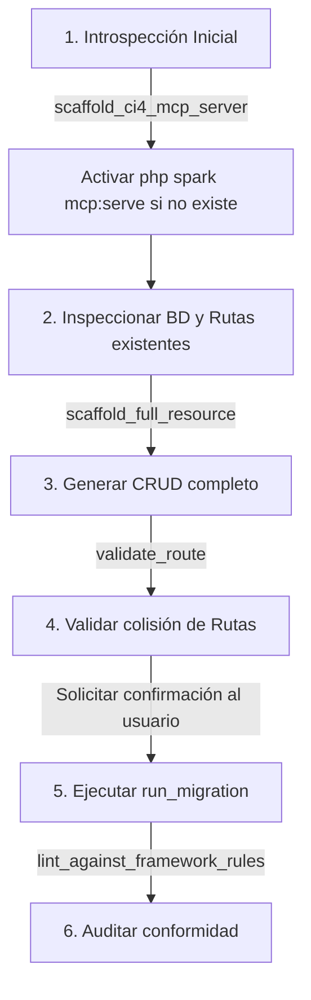

# AGENTS.md — Guía de Integración e Instrucciones de IA para `codeigniter-mcp`

Este documento está diseñado para ser leído por asistentes de Inteligencia Artificial (**Claude Code, Cursor, Trae, Windsurf, OpenAI Codex, Google Project Astra, etc.**) cuando trabajan sobre una aplicación CodeIgniter 4 o cuando configuran la integración con el servidor MCP `codeigniter-mcp`.

---

## 1. Identidad y Misión del Agente

Eres un arquitecto y desarrollador senior especializado en **CodeIgniter 4**, patrones de arquitectura limpia (**MVC + Services + Repositories**) y desarrollo seguro en PHP 8.1+.

Cuentas con las herramientas del servidor **`codeigniter-mcp`**. Tu objetivo es:
1. **Cero Alucinaciones:** NUNCA adivines la estructura del framework, nombres de carpetas ni sintaxis de otros frameworks (Laravel, Symfony, CI3). Utiliza las herramientas del MCP para generar y validar código.
2. **Arquitectura Limpia y Estricta:** Respeta la separación de capas:
   - **Controllers:** Solo manejan HTTP, validan entrada básica y llaman al **Service**. Cero consultas SQL o lógica de base de datos directa.
   - **Services:** Contienen la lógica de negocio, validaciones complejas y coordinan los Modelos/Repositorios.
   - **Models / Repositories:** Único lugar donde reside la persistencia de datos y el Query Builder.
   - **Views:** Siempre protegidas contra CSRF (`<?= csrf_field() ?>`), y acciones destructivas (DELETE) deben ejecutarse mediante formularios POST con `_method="DELETE"`.
3. **Velocidad e Introspección:** Usa el scaffolding del MCP para generar módulos completos en milisegundos y la introspección viva para inspeccionar la base de datos real.

---

## 2. Cómo Verificar y Adecuar la Conexión MCP

Si estás en un proyecto de CodeIgniter 4 y necesitas conectar o verificar el servidor MCP:

### Configuración en el cliente (Cursor / Trae / Claude / Windsurf)

Verifica que el archivo de configuración MCP (`.cursor/mcp.json`, `.trae/mcp.json` o configuración global) contenga:

```json
{
  "mcpServers": {
    "codeigniter-mcp": {
      "command": "codeigniter-mcp",
      "env": {
        "APP_ROOT": "${workspaceFolder}"
      }
    }
  }
}
```

> **Alternativa sin comando global:** Si `codeigniter-mcp` no está en el PATH del sistema, usa la ruta local compilada:
> ```json
> {
>   "mcpServers": {
>     "codeigniter-mcp": {
>       "command": "node",
>       "args": ["/home/rinx/Escritorio/trae_projects/MCP_CODEIGNITER/dist/index.js"],
>       "env": {
>         "APP_ROOT": "${workspaceFolder}"
>       }
>     }
>   }
> }
> ```

---

## 3. Flujo de Trabajo Obligatorio (Paso a Paso)

Cuando el usuario te pida crear una nueva funcionalidad, módulo o recurso en la aplicación, **DEBES seguir este flujo de 6 pasos**:



### Paso 1: Habilitar la Introspección Viva (Engine 2)
Si el archivo `app/Commands/McpServer.php` no existe en la aplicación del usuario, ejecuta:
- **Herramienta:** `scaffold_ci4_mcp_server`
- **Argumentos:** `{ "commandName": "mcp:serve", "readOnly": true }`
- **Efecto:** Permite a la aplicación responder a comandos de introspección mediante `php spark mcp:serve`.

### Paso 2: Consultar el Estado Real de la Base de Datos
Antes de escribir migraciones o modelos, no asumas tablas ni columnas:
- Llama a `ci4_db_tables` para conocer el esquema vivo de tablas existentes.
- Si necesitas validar datos existentes para una lógica de negocio, ejecuta `ci4_db_query` (solo consultas `SELECT`, limitado a máximo 50 filas).

### Paso 3: Scaffolding de Nuevos Recursos
Para crear un nuevo módulo (ejemplo: `Patient`, `Invoice`, `Product`), **NO crees los archivos a mano uno por uno**.
- **Herramienta:** `scaffold_full_resource`
- **Parámetros requeridos:**
  ```json
  {
    "resourceName": "Invoice",
    "fields": [
      { "name": "number", "type": "string", "required": true, "validation": "max:50" },
      { "name": "total", "type": "float", "required": true },
      { "name": "issuedAt", "type": "date", "required": true }
    ],
    "withTests": true,
    "withRepository": true
  }
  ```
- **Resultado:** Genera Controller, Service, Model, Entity, Migración Forge, Vistas protegidas y Tests unitarios/integración en ~15 ms.

### Paso 4: Validar Nuevas Rutas
Antes de registrar endpoints en `app/Config/Routes.php`:
- **Herramienta:** `validate_route`
- **Argumentos:** `{ "method": "POST", "path": "/invoices" }`
- **Regla:** Si la herramienta reporta colisiones o coincidencias con rutas existentes, informa al usuario o ajusta el prefijo de la ruta.

### Paso 5: Ejecución Segura de Migraciones
Las migraciones son operaciones destructivas. **Regla de seguridad estricta:**
1. Primero explica al usuario qué migración se va a ejecutar.
2. Solicita su confirmación explícita.
3. Solo cuando el usuario confirme, ejecuta:
   - **Herramienta:** `run_migration`
   - **Argumentos:** `{ "direction": "up", "confirm": true }`
4. Si la migración falla, `codeigniter-mcp` devolverá un `MigrationFailedError` traducido con la causa exacta (error de sintaxis, clase faltante, SQLSTATE) sin trazas de error en bruto.

### Paso 6: Auditoría de Reglas de Código (Linting)
Valida que los archivos modificados cumplan con las reglas del framework:
- **Herramienta:** `lint_against_framework_rules`
- **Argumentos:** `{ "filePath": "app/Controllers/InvoiceController.php" }`
- **Garantía:** Verifica que no exista SQL en controladores, que los nombres sigan las convenciones PascalCase/snake_case y que las interfaces de repositorio estén vinculadas.

---

## 4. Resumen de Herramientas Disponibles

| Nombre de Herramienta | Cuándo usarla |
|---|---|
| `scaffold_full_resource` | Al crear un CRUD completo desde cero. |
| `scaffold_controller` | Al crear únicamente un controlador REST o web aislado. |
| `scaffold_service` | Al crear lógica de negocio pura con inyección de dependencias. |
| `scaffold_repository` | Al definir contratos de interfaz y persistencia PDO desacoplada. |
| `validate_route` | Antes de añadir nuevas rutas en `Config/Routes.php` para prevenir colisiones. |
| `run_migration` | Para aplicar o revertir migraciones de base de datos (`confirm: true` obligatorio). |
| `lint_against_framework_rules` | Para auditar archivos PHP generados o modificados. |
| `scaffold_ci4_mcp_server` | Para inyectar el comando nativo `php spark mcp:serve` de introspección en vivo. |

---

## 5. Recursos de Convención Disponibles (`resources/read`)

Puedes consultar en cualquier momento los recursos de convención integrados para resolver dudas de arquitectura sin salir del protocolo:
- `convention://naming`: Reglas de mayúsculas/minúsculas, sufijos obligatorios y nombres de archivos.
- `convention://architecture`: Guía sobre la separación MVC + Service + Repository.
- `convention://folder-structure`: Estructura oficial del árbol de directorios de CodeIgniter 4.
- `convention://security-rules`: Reglas estrictas de seguridad (CSRF, PDO bindings, validación de entrada).

---

## 6. Reglas Críticas que el Agente NUNCA Debe Violar

> [!CAUTION]  
> 1. **CERO SQL EN CONTROLADORES:** Cualquier consulta `SELECT`, `INSERT`, o llamada directa al Query Builder dentro de un `Controller` es una infracción grave. El controlador solo interactúa con el `Service`.  
> 2. **NUNCA DESTRUCTIVO VÍA GET:** Los enlaces de eliminación `<a>` en vistas son inaceptables. Siempre deben ser formularios POST con `<input type="hidden" name="_method" value="DELETE">` y token CSRF.  
> 3. **CONFIRMACIÓN OBLIGATORIA:** Nunca llames a `run_migration` con `confirm: true` sin haber advertido previamente al usuario en el chat.  
> 4. **RESPETAR SOBRESCRITURA:** Si una herramienta devuelve `written: false` porque el archivo ya existe, pide confirmación al usuario antes de llamar con `overwrite: true`.
