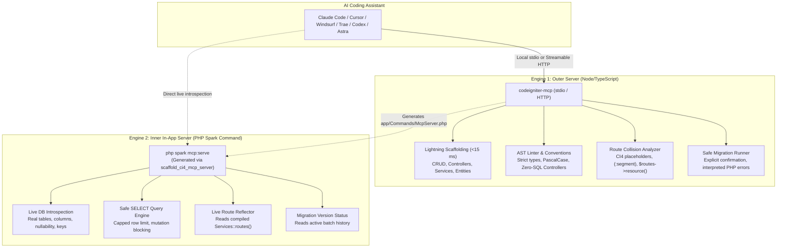

# codeigniter-mcp

[](https://www.npmjs.com/package/codeigniter-mcp)
[](https://www.npmjs.com/package/codeigniter-mcp)
[](LICENSE)
[](https://github.com/AntigamerISK/codeigniter-mcp/actions)
[](docs/testing.md)
[](package.json)
[](https://semver.org/)

**Model Context Protocol (MCP)** server built for high-velocity AI development on **CodeIgniter 4** and modern PHP architectures (**MVC + Services/Repository** layer).

Eliminates LLM hallucinations, scaffolds complete production-ready modules in **<15 milliseconds**, and unlocks **real-time live database and route introspection** directly inside your AI IDE (Claude Code, Cursor, Windsurf, Trae, OpenAI Codex, and Google Project Astra).

---

## Architecture: The "Top 1%" Dual-Engine Design

Most MCP servers are either purely external (blind to running application state) or heavy PHP extensions. `codeigniter-mcp` uses a **Dual-Engine Architecture** bridging the best of both worlds:



1. **Outer Engine (`codeigniter-mcp`)**: Runs in Node/TypeScript over `stdio` or `http`. Handles sub-millisecond code scaffolding, static syntax validation, and route collision checks without touching PHP runtime dependencies.
2. **Inner Engine (`php spark mcp:serve`)**: Scaffolds a zero-dependency, native CodeIgniter 4 Spark command (`app/Commands/McpServer.php`) that runs a pure JSON-RPC 2.0 MCP server over stdio for real-time live schema reflection, safe read-only SQL queries, and compiled route inspection.

---

## Highlights

- **8 Production Tools**: Complete CRUD scaffolding, modular controllers, services, repositories, route validation, migration runner, AST convention linter, and native CI4 MCP server generator.
- **Vibecoding Ready (Zero Hallucinations)**: The AI assistant never confuses CI3, Laravel, and CI4 syntax. Generates clean `BaseController`, dependency-injected Services, Query Builder Models, and CSRF-protected forms.
- **Enterprise-Grade Security**:
  - **Symlink Traversal Mitigation**: Canonical `realpathSync` resolution prevents reading or writing outside `APP_ROOT`.
  - **DNS Rebinding Protection**: Enforces strict `Host` header matching (returns 403 Forbidden).
  - **HTTP API Key Authentication**: Supports `Authorization: Bearer <key>` or `X-API-Key` headers.
  - **Safe PDO Mutations**: Prevents false 404s on unchanged MySQL row updates (`rowCount() > 0 || $this->findById($id)`).
  - **Destructive Operations Guarded**: Requires explicit `confirm: true` or `overwrite: true`.
- **4 Convention Resources + 3 Token-Saving Prompts**: Compact prompt templates save token context and speed up LLM responses.

---

## Quickstart

### Run with `npx` (No installation needed)

```bash
npx -y codeigniter-mcp
```

### Install globally

```bash
npm install -g codeigniter-mcp
```

### From source (Contributors)

```bash
git clone https://github.com/AntigamerISK/codeigniter-mcp.git
cd codeigniter-mcp
npm install
npm run build
npm test
npm run verify
```

---

## IDE & AI Agent Configuration

### 1. Claude Code / Claude Desktop

Add to `claude_desktop_config.json` or run `claude mcp add codeigniter-mcp`:

```json
{
  "mcpServers": {
    "codeigniter-mcp": {
      "command": "npx",
      "args": ["-y", "codeigniter-mcp"],
      "env": {
        "APP_ROOT": "/absolute/path/to/your/codeigniter4_project",
        "RATE_LIMIT_PER_MINUTE": "30"
      }
    }
  }
}
```

### 2. Cursor / Windsurf / Trae

In your project root or global settings (`.cursor/mcp.json` or settings UI):

```json
{
  "mcpServers": {
    "codeigniter-mcp": {
      "command": "npx",
      "args": ["-y", "codeigniter-mcp"],
      "env": {
        "APP_ROOT": "/absolute/path/to/your/codeigniter4_project"
      }
    }
  }
}
```

### 3. Remote Agents / OpenAI Codex / Google Project Astra (Streamable HTTP)

For cloud agents that connect over HTTP instead of spawning local sub-processes:

```bash
# Start server in HTTP mode
MCP_TRANSPORT=http MCP_PORT=3000 MCP_BIND_HOST=127.0.0.1 MCP_API_KEY=secret_token APP_ROOT=/path/to/project npx codeigniter-mcp
```

Configure your remote AI agent:

```json
{
  "mcpServers": {
    "codeigniter-mcp": {
      "url": "http://127.0.0.1:3000/mcp",
      "headers": {
        "Authorization": "Bearer secret_token"
      }
    }
  }
}
```

---

## Available Tools (8 Tools)

| Tool | Purpose | Key Parameters |
|---|---|---|
| `scaffold_full_resource` | Generates full CRUD in **~15 ms**: Controller + Service + Model/Repository + Migration + View + Tests (8 files). | `resourceName`, `fields[]`, `withTests`, `withRepository`, `overwrite` |
| `scaffold_controller` | Generates standalone Controller with strict validation; enforces zero SQL in controllers. | `resourceName`, `methods[]`, `fields[]`, `overwrite` |
| `scaffold_service` | Generates business logic Service with contract-first DI (injects Model in CI4). | `resourceName`, `fields[]`, `withRepository`, `overwrite` |
| `scaffold_repository` | Generates Repository interface + PDO implementation (no-op in CI4, data lives in Models). | `resourceName`, `overwrite` |
| `validate_route` | Analyzes `app/Config/Routes.php` to detect route collisions, CI4 placeholders (`(:num)`, `(:segment)`), and `$routes->resource()`. | `method`, `path` |
| `run_migration` | Executes native migrations (`spark migrate` or `bin/migrate`). Interprets PHP errors into actionable messages; requires explicit confirmation. | `direction` (`up`\|`down`), `confirm` (bool) |
| `lint_against_framework_rules` | Lints PHP source code against framework conventions and AST security rules. | `filePath` |
| `scaffold_ci4_mcp_server` | Scaffolds native CI4 in-app MCP command (`app/Commands/McpServer.php`) for live runtime introspection via `php spark mcp:serve`. | `commandName`, `className`, `readOnly`, `overwrite` |

---

## In-App Live Introspection (`php spark mcp:serve`)

Once you run `scaffold_ci4_mcp_server`, your CodeIgniter 4 application gains its own native MCP server:

```bash
php spark mcp:serve
```

This exposes live runtime tools to your AI assistant:
- **`ci4_db_tables`**: Reflects active database schema, columns, data types, and primary keys.
- **`ci4_db_query`**: Runs safe, read-only `SELECT` queries (capped at 50 rows, destructive keywords blocked).
- **`ci4_routes_list`**: Reads dynamically compiled routes directly from `Services::routes()`.
- **`ci4_migration_status`**: Queries `Services::migrations()` for active and pending migration batches.

---

## Token-Saving Prompts (3 Prompts)

Compact input templates that minimize token consumption:

| Prompt | Description |
|---|---|
| `create_full_resource` | Converts compact definitions (e.g. `Patient fullName:string:true, age:int:false`) into exact tool parameters. |
| `run_migration` | Prepares migration direction while enforcing safety confirmation. |
| `lint_file` | Directs the model to inspect and repair a specific file against framework standards. |

---

## Convention Resources (4 Resources)

Read-only context injected into the LLM context window:
- `convention://naming`: Rules for PascalCase, camelCase, kebab-case, and mandatory suffixes.
- `convention://architecture`: Explains MVC + Service + Repository separation.
- `convention://folder-structure`: CodeIgniter 4 directory tree mapping.
- `convention://security-rules`: Guidelines for CSRF tokens, PDO parameterized statements, and strict typing.

---

## Configuration Variables

| Variable | Default | Description |
|---|---|---|
| `APP_ROOT` | — | **Required.** Absolute path to the PHP application root directory. |
| `RATE_LIMIT_PER_MINUTE` | `20` | Maximum write/scaffold operations permitted per minute per session. |
| `MCP_TRANSPORT` | `stdio` | Communication protocol (`stdio` or `http`). |
| `MCP_PORT` | `3000` | Port for Streamable HTTP transport mode. |
| `MCP_BIND_HOST` | `127.0.0.1` | Local IP binding to guard against DNS rebinding attacks. |
| `MCP_API_KEY` | — | Optional Bearer token or X-API-Key required for HTTP transport. |
| `PHP_BINARY` | `php` | Path or name of the PHP CLI binary to execute. |

---

## Testing & Quality Assurance

```bash
# Run complete test suite (165 tests across 17 files)
npm test

# Typecheck with zero warnings
npm run typecheck

# Acceptance checklist against real stdio MCP transport
npm run verify
```

```
codeigniter-mcp — acceptance checklist

  ✅  Handshake: serverInfo.name = codeigniter-mcp
  ✅  Exposes 8 tools (found 8)
  ✅  Exposes 4 convention resources (found 4)
  ✅  Exposes 3 token-saving prompts (found 3)
  ✅  scaffold_full_resource creates 8 files on disk (7 ms)
  ✅  php -l passes on all generated files (8 files OK)
  ✅  lint_against_framework_rules → compliant
  ✅  validate_route POST /orders → valid
  ✅  run_migration without confirm → blocked (zero executions)
  ✅  run_migration with confirm=true executes via bin/migrate
  ✅  scaffold again → no overwrite, 8 files skipped
  ✅  Path traversal outside APP_ROOT → ValidationError
  ✅  Runner failure → actionable MigrationFailedError

Result: 13 passed · 0 failed · 0 skipped
```

---

## Documentation

- [docs/tools.md](docs/tools.md) — Comprehensive parameter references for all 8 tools.
- [docs/profiles.md](docs/profiles.md) — Profiles, auto-detection (`ci4` vs `spec`), and configuration.
- [docs/security.md](docs/security.md) — Deep dive into the security architecture and guardrails.
- [docs/testing.md](docs/testing.md) — Testing strategy, E2E fixtures, and CI automation.

---

## Contributing

Contributions are welcome! Please read [CONTRIBUTING.md](CONTRIBUTING.md) before submitting pull requests.

## License

Distributed under the **MIT License**. See [LICENSE](LICENSE) for more information.
