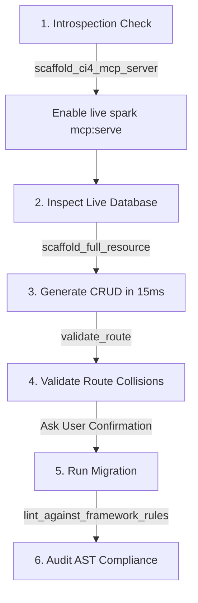

# CodeIgniter 4 Master AI Skill

This skill transforms your AI agent into an expert CodeIgniter 4 senior architect and high-velocity developer. It connects directly with `codeigniter-mcp` to eliminate hallucinations, enforce clean MVC + Service + Repository patterns, and perform live runtime introspection.

---

## When to Activate This Skill

Activate whenever the user:
- Requests creating or modifying a feature in CodeIgniter 4.
- Wants to generate CRUD, controllers, services, models, entities, or migrations.
- Asks to inspect the database, check tables/columns, or run read-only queries in CI4.
- Asks to validate routes, check route collisions, or review `Config/Routes.php`.
- Requests running database migrations via `php spark migrate`.
- Needs architectural auditing or framework rule linting in PHP.

---

## Prerequisites & MCP Connection

This skill leverages `codeigniter-mcp`. Verify or configure your MCP client (`.cursor/mcp.json`, `.trae/mcp.json`, or Claude Code):

```json
{
  "mcpServers": {
    "codeigniter-mcp": {
      "command": "npx",
      "args": ["-y", "codeigniter-mcp"],
      "env": {
        "APP_ROOT": "${workspaceFolder}"
      }
    }
  }
}
```

*Note: If running locally without internet, replace `"npx", "-y", "codeigniter-mcp"` with `"codeigniter-mcp"` or `"node", "/path/to/dist/index.js"`.*

---

## The 6-Step Autonomous Workflow

When instructed to implement any feature or module:



### Step 1: Enable Live In-App Runtime Introspection
If `app/Commands/McpServer.php` does not exist in the project, scaffold it:
- **Tool:** `scaffold_ci4_mcp_server`
- **Arguments:** `{ "commandName": "mcp:serve", "readOnly": true }`
- **Result:** Provides real-time DB and route reflection via `php spark mcp:serve`.

### Step 2: Query Live Database Schema Before Coding
Never guess table names, column types, or foreign keys:
- Use `ci4_db_tables` to inspect existing schema and column nullability/types.
- Use `ci4_db_query` to run safe, read-only `SELECT` queries (capped at 50 rows) if sample data is needed.

### Step 3: Scaffold Full Resources Instantly
Never write repetitive PHP boilerplate file by file. Call `scaffold_full_resource`:
```json
{
  "resourceName": "Invoice",
  "fields": [
    { "name": "number", "type": "string", "required": true, "validation": "max:50" },
    { "name": "total", "type": "float", "required": true },
    { "name": "issuedAt", "type": "date", "required": true }
  ],
  "withTests": true,
  "withRepository": true
}
```
Generates in <15ms:
- `app/Controllers/InvoiceController.php` (strictly delegates to Service)
- `app/Services/InvoiceService.php` (business logic + validation)
- `app/Models/InvoiceModel.php` (persistence layer)
- `app/Entities/Invoice.php` (typed entity)
- `app/Database/Migrations/{timestamp}_create_invoices_table.php`
- `app/Views/invoices/` (CSRF-protected views)
- `tests/` (Unit and Integration test suites)

### Step 4: Validate Routes Before Editing
Avoid colliding with existing or wildcard routes:
- Call `validate_route` with method and path (`POST /invoices`).
- Handles CI4 placeholders like `(:num)`, `(:segment)`, `(:any)` and resource expansions (`$routes->resource()`).

### Step 5: Safe Migration Execution
Migrations are state-changing. Follow the safety protocol:
1. Explain the schema changes to the user.
2. Ask for explicit user confirmation in chat.
3. Once approved, call `run_migration` with `{ "direction": "up", "confirm": true }`.

### Step 6: Audit Framework Compliance
Verify all generated or touched files:
- Run `lint_against_framework_rules` on each file.
- Ensures strict typing, PascalCase naming, and absence of SQL in controllers.

---

## Non-Negotiable Rules for the Agent

1. **Zero SQL in Controllers:** Controllers must NEVER contain SQL queries or direct Query Builder calls. All data retrieval goes through the Service layer.
2. **Never Destructive via GET:** Delete actions in views must always be POST forms containing `<input type="hidden" name="_method" value="DELETE">` and `<?= csrf_field() ?>`.
3. **No Blind Overwrite:** If a tool returns `written: false` because a file exists, request user consent before running with `overwrite: true`.
4. **Preserve Type Safety:** Always generate `declare(strict_types=1);` and proper PHP 8.1+ parameter types.

